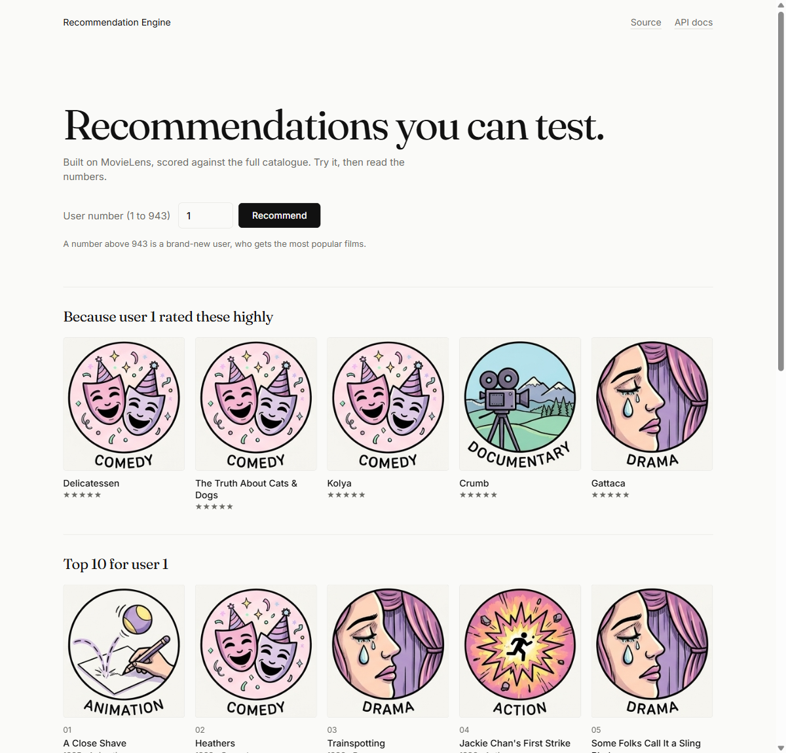
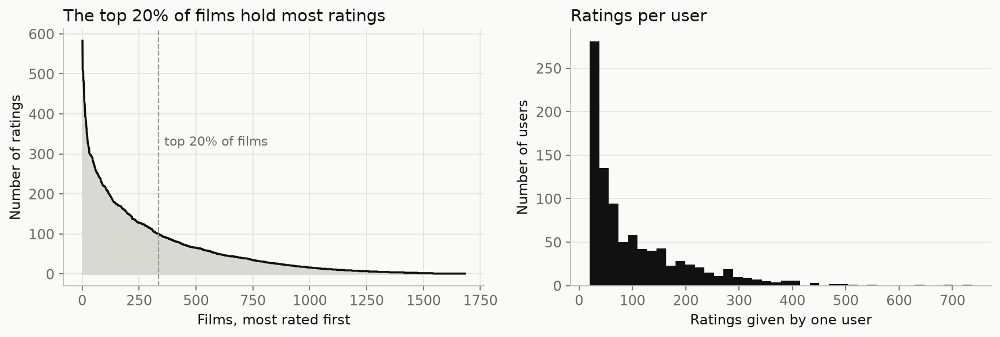
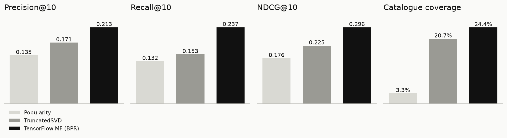

# Recommendation Engine


[](https://huggingface.co/spaces/Onkar-Gupta-HF/recommendation-engine)

A recommender tutorial that does not stop at a notebook: data to a trained TensorFlow model to a live API, in one command. It beats a standard scikit-learn SVD baseline on every ranking metric, not just rating accuracy.

**Try it now, no install:** [live demo on Hugging Face](https://huggingface.co/spaces/Onkar-Gupta-HF/recommendation-engine). It shows saved answers from the model's API, so it runs without a server and never sleeps.

## Quick Start

```bash
git clone https://github.com/Onkar-Gupta/recommendation-engine.git
cd recommendation-engine
make all                    # Windows: .\run.ps1 all   (setup, download data, train, serve)
# then open http://127.0.0.1:8000 and try:  curl "http://127.0.0.1:8000/recommend/1?k=3"
```



## What it does

You give it user, item and rating data. It learns each user's taste with a TensorFlow matrix factorisation model trained to rank, and serves recommendations over a FastAPI service with a small web page on top.

- Trains with a pairwise ranking loss (BPR), so the model learns the order of films, not just a guess at the star rating.
- Evaluates against the full catalogue, with five metrics: RMSE, Precision@10, Recall@10, NDCG@10 and catalogue coverage.
- Serves `/recommend`, `/similar`, `/history` and `/health`. New users get the most popular items.
- Runs on your own CSV with a config change, no code edits.

## Results

MovieLens 100K. Per-user 80/20 split, "relevant" means a test rating of 4 or more, and every user is ranked against all 1,682 films (not a sampled subset).

| Model | RMSE | Precision@10 | Recall@10 | NDCG@10 | Catalogue coverage |
|---|---|---|---|---|---|
| Popularity (no personalisation) | 1.126 | 0.135 | 0.132 | 0.176 | 3.3% |
| TruncatedSVD (scikit-learn) | 1.040 | 0.171 | 0.153 | 0.225 | 20.7% |
| **TensorFlow MF, BPR-trained (this repo)** | 2.561 | **0.213** | **0.237** | **0.296** | **24.4%** |

Every number comes from `reports/metrics.json`, written by `python -m src.train` and `python -m src.baselines`. `scripts/sweep.py` is the 10-trial hyperparameter sweep behind the final config.

**Why is RMSE higher?** BPR teaches the model the order of films, not calibrated star ratings, so its predicted ratings drift away from the real 1 to 5 scale. For a system whose job is "what should I show first", ranking quality is the metric that matters. RMSE is reported anyway so nobody has to wonder.

**Why report coverage?** A model can score well on precision and recall while recommending the same handful of popular films to everyone. This repo hit exactly that once, so coverage is now a tracked metric with its own test.

### Evaluation protocol

Ranking against the whole catalogue is harder and more realistic than the protocol many papers use, which ranks against about 100 sampled negatives. Their reported HR@10 and NDCG@10 figures (often 0.7 to 0.9) are therefore not comparable to the table above. Under the same full-catalogue protocol, a well-tuned pairwise model typically reaches P@10 of about 0.25 to 0.30 on this dataset (the Microsoft `recommenders` benchmarks are the reference). Recall@10 here (0.237) sits inside that range. Precision@10 (0.213) is close behind.

## Exploring the data

[`notebooks/exploration.ipynb`](notebooks/exploration.ipynb) walks through the rating distribution, the long tail and the model comparison, with outputs saved. To re-run it: `pip install -r requirements-notebook.txt`.





## How it works

```
ratings CSV
    |
    v
data_loader  --> split per user (80/20) --> BPR training (TensorFlow) --> models/tf_mf.keras
                                                  |                          |
                                                  v                          v
                                         evaluate (full catalogue)     serve (FastAPI) --> web page, /recommend, /similar
                                                  |
                                                  v
                                         reports/metrics.json
```

## Project structure

```
recommendation-engine/
├── config.yaml            # every path, hyperparameter and column name
├── Makefile, run.ps1      # one-command targets (Unix, Windows)
├── Dockerfile
├── requirements.txt, requirements-serve.txt, requirements-notebook.txt
├── data/sample/           # small synthetic CSVs: movie-like and e-commerce-like
├── notebooks/             # exploration.ipynb with saved outputs
├── docs/images/           # screenshot, charts and the artwork sheet
├── scripts/               # download_data.py, sweep.py
├── src/
│   ├── data_loader.py     # load any user/item/rating CSV, map ids, split
│   ├── baselines.py       # Popularity and TruncatedSVD
│   ├── model.py           # the TensorFlow matrix factorisation model
│   ├── train.py           # BPR training, evaluation, saving
│   ├── evaluate.py        # RMSE, Precision, Recall, NDCG, coverage
│   ├── serve.py           # FastAPI app (NumPy and pandas only)
│   ├── weights.py         # save the trained numbers, score from them without TensorFlow
│   ├── middleware.py      # optional API key check and usage log
│   └── static/            # the web page and genre artwork
└── tests/
```

## Configuration

All settings live in `config.yaml`. The ones you will touch most:

| Setting | What it controls |
|---|---|
| `data.columns` | which CSV columns hold user, item, rating and timestamp |
| `training.embedding_dim`, `training.l2_reg`, `training.bpr_*` | model size, regularisation and BPR training |
| `evaluation.top_k`, `evaluation.relevant_rating_threshold` | the K in the metrics and what counts as a liked item |
| `serving.default_k`, `serving.max_k` | list length the API returns by default and its upper limit |
| `serving.ratings_path`, `serving.item_titles_path` | data the server reads (titles are optional) |
| `auth.enabled` | require an `X-API-Key` header (presence check only) |

## Use your own data

Any CSV with a user, an item, a rating and a timestamp works. The e-commerce sample in `data/sample/ecommerce_sample.csv` calls its item column `product_id`, so it is a good worked example.

1. In `config.yaml`, point the column names at your CSV (here: `data.columns.item: product_id`).
2. Train: `python -m src.train --data data/sample/ecommerce_sample.csv`
3. In `config.yaml`, set `serving.ratings_path` to the same file and leave `serving.item_titles_path` empty.
4. Serve: `uvicorn src.serve:create_app --factory`

Or train in one go with `make train-custom DATA=path/to/my.csv` (Windows: `.\run.ps1 train-custom -Data path\to\my.csv`).

Without a titles file, the web page shows "Item 50035" instead of a film name and a plain icon instead of genre artwork.

## API

Start it with `make serve`, then open `/` for the web page or `/docs` for the interactive API page.

| Endpoint | What it returns |
|---|---|
| `GET /health` | status, model version, dataset name |
| `GET /history/{user_id}?k=5` | the films that user rated highest, so you can see why the picks make sense |
| `GET /recommend/{user_id}?k=10` | top-k unseen items. Unknown users get the most popular items (`strategy: "popular"`) |
| `GET /similar/{item_id}?k=10` | the k nearest items by embedding cosine similarity. 404 for an unknown item |

```bash
curl "http://127.0.0.1:8000/recommend/1?k=3"
```

`k` is capped by `serving.max_k`. Every request is logged to `logs/api_usage.jsonl`.

## Docker

The image holds code only. It reads the model and data you trained locally, so one image serves any trained model. The server runs on NumPy and pandas without TensorFlow (`requirements-serve.txt`), which keeps the image small and the memory use low (about 116 MB in my test, against about 464 MB with TensorFlow).

```bash
make train
make docker-build && make docker-run     # Windows: .\run.ps1 docker-build, then .\run.ps1 docker-run
curl localhost:8000/health
```

## Why this repo?

Surprise, LightFM and Implicit are libraries. This repo is a small working service built around one model. They do different jobs, and some of theirs are better.

| | This repo | Surprise | LightFM | Implicit |
|---|---|---|---|---|
| Training pipeline from CSV to saved model | Yes | No, you write it | No, you write it | No, you write it |
| Serves an API | Yes | No | No | No |
| Dockerised | Yes | No | No | No |
| Deploys to cloud | Not yet (on the roadmap) | No | No | No |
| Swap-your-data CLI | Yes | No | No | No |
| Number of algorithms | One, plus two baselines | Many | A few | Several |

What they do better:

- **Surprise** has a wide set of classic rating-prediction algorithms (SVD, SVD++, NMF, k-NN) and mature cross-validation tools.
- **LightFM** supports hybrid models that use user and item features, and the WARP loss. This repo uses neither.
- **Implicit** is much faster on large implicit-feedback data, with multithreaded and GPU support.

If you need a research toolkit, use them. If you want to see the whole path from data to a live recommender, with honest evaluation, this is that.

## Background

A rebuild of my 2024 SVD-based recommender from the Department of Science and Technology and IIT Roorkee programme, this time in TensorFlow, with ranking-based training, full-catalogue evaluation and a served API.

## Roadmap

- [x] FastAPI serving, web page and Docker
- [x] Hyperparameter sweep, NDCG@10 and catalogue coverage metrics
- [x] Free demo on Hugging Face Spaces (static, saved answers)
- [ ] Live API on a free host
- [x] Serve without TensorFlow (about 75% less memory)
- [ ] pip-installable command line tool
- [ ] Implicit feedback support (clicks and purchases without ratings)
- [ ] Hybrid model using item and user features
- [ ] Real-time model updates
- [ ] Hosted API tier

## Licence

MIT. See [LICENSE](LICENSE).

## Author

Onkar Gupta. [LinkedIn](https://linkedin.com/in/onkar-gupta-ai)
